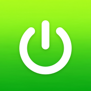

# DAYON - Treino



Diário de treino de musculação e de peso corporal para iPhone e Android, em português do Brasil.

- **Sem cadastro e sem servidor.** O app abre direto no modo local: os treinos, pesagens e
  medidas ficam guardados no próprio celular. Nada é enviado para lugar nenhum.
- **Progressão automática**, biblioteca com milhares de exercícios, rotinas, gráficos,
  temporizador de descanso, lembretes e integração com o app Saúde.
- **Servidor próprio é opcional.** Quem quiser sincronizar entre aparelhos pode ligar o app a
  um servidor (Docker), mas isso nunca é necessário para usar.

## Para quem vai mexer no código

| O quê | Onde |
|---|---|
| Relatório do estado atual (o que foi feito, como instalar no iPhone, próximos passos) | [RELATORIO-DAYON.md](RELATORIO-DAYON.md) |
| Notas rápidas do projeto Dayon | [LEIA-ME-DAYON.md](LEIA-ME-DAYON.md) |
| Instalar no iPhone por cabo | `./scripts/instalar-no-iphone.sh` |
| Abrir no Simulador do iOS | `./scripts/testar-no-simulador.sh` |
| Mapa técnico do código (em inglês) | [CLAUDE.md](CLAUDE.md), [docs/](docs/README.md) |

Comandos principais (Node 22 ou 24):

```bash
cd frontend && npm ci          # dependências
npm test                       # testes
npm run build:mobile           # app do celular (web + Capacitor + pod install)
```

## Licença e créditos

O DAYON - Treino é uma versão modificada do [openGym](https://github.com/DuarteSantos8/openGym),
de Duarte Santos, e continua sendo software livre sob a **GNU AGPL v3 ou posterior**
([LICENSE](LICENSE)). O código-fonte deste projeto está em
[github.com/leosantoscba7/dayon-treino](https://github.com/leosantoscba7/dayon-treino).
No site, o link "Código-fonte" (em letra miúda no rodapé do Início e em Ajustes → Sobre)
aponta para esse repositório. Os avisos de autoria do openGym original foram mantidos
(NOTICE.md, LICENSE, este README).

As imagens e animações dos exercícios **não** fazem parte deste repositório e **não** são AGPL:
são de [Gym visual](https://gymvisual.com/), licenciadas para uso no openGym. Este fork não
redistribui essa mídia. Para rodar o app no celular com as figuras, obtenha uma cópia licenciada
(por exemplo a partir de um checkout do [openGym](https://github.com/DuarteSantos8/openGym),
pastas `catalogue/media/still` e `catalogue/media/clip`, ou uma licença direta no Gym visual)
e coloque os arquivos nessas pastas antes do `npm run build:mobile`. O site publicado não serve
essas mídias. Detalhes em [NOTICE.md](NOTICE.md) e [catalogue/media/NOTICE.md](catalogue/media/NOTICE.md).
Os fluxos de CI do openGym (`.github/workflows/`) não entram neste repositório público:
eles apontam para a infraestrutura do projeto original e não devem rodar nesta conta.

