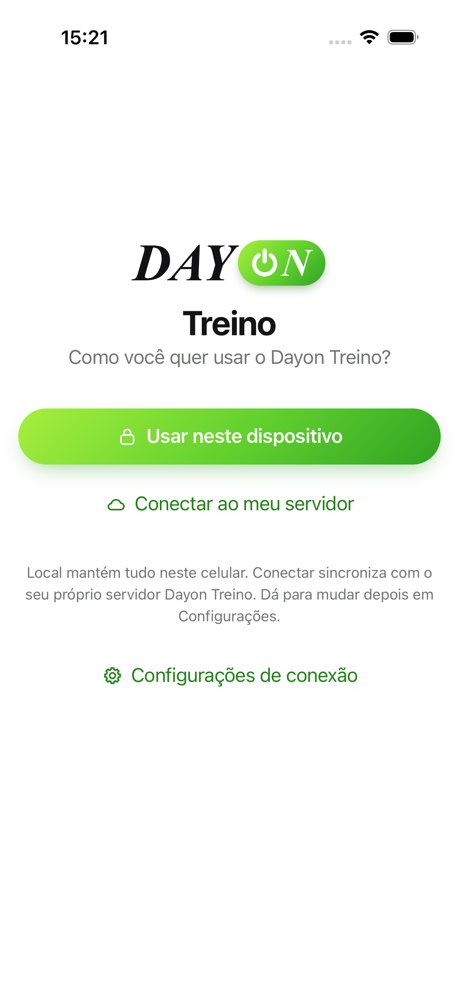
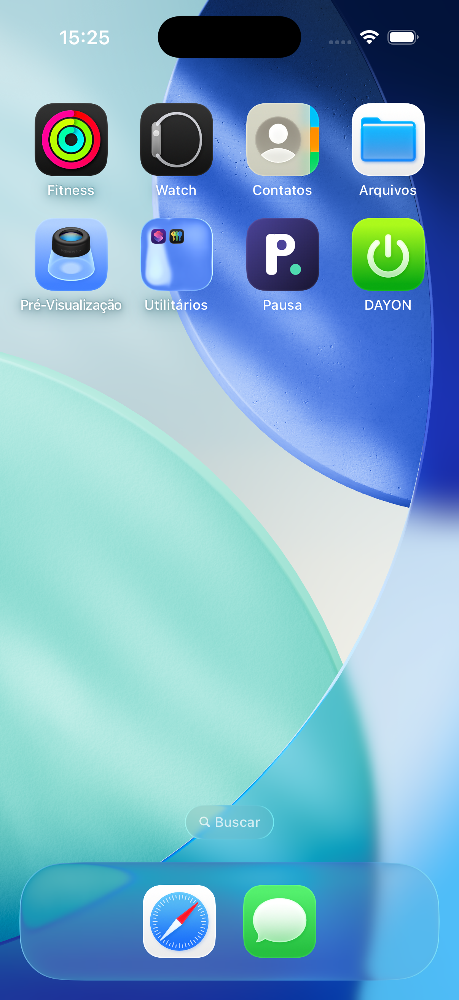
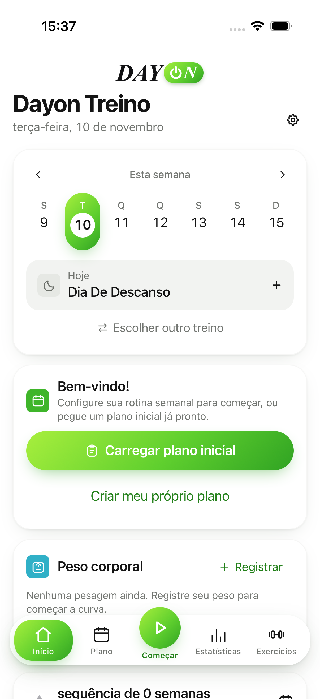
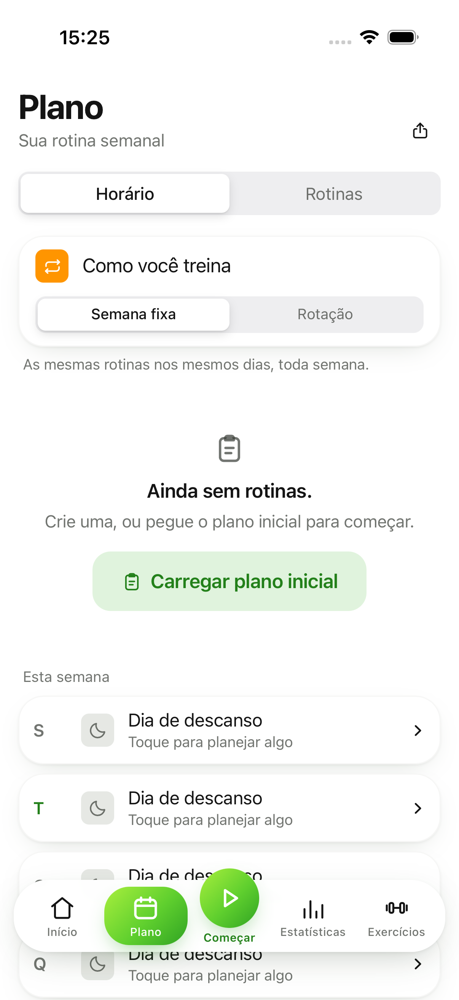
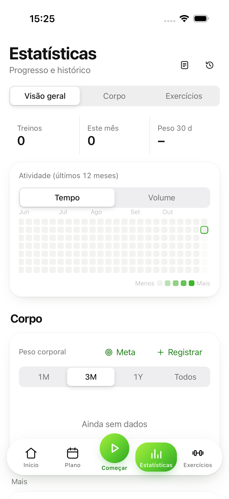
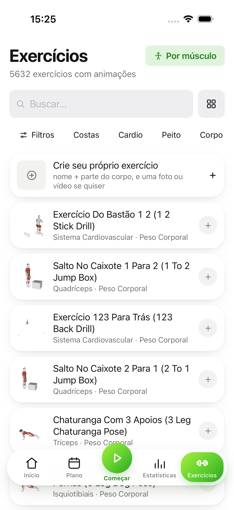
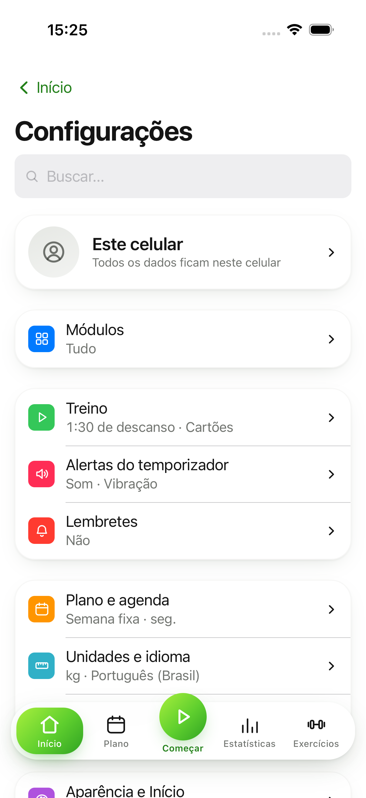
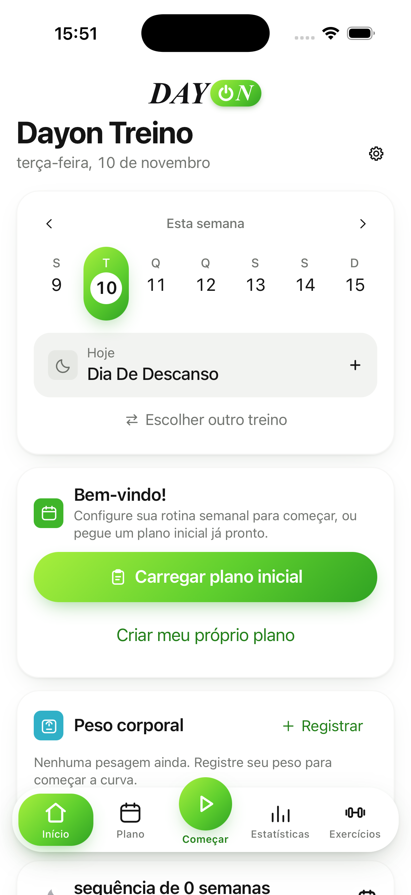

# Relatório: DAYON - Treino (MVP)

*10 de novembro de 2026 (atualizado com a identidade DAY ON, o alinhamento da organização com o openGym, a retirada do cartão de check-in do Início, o push remoto via Firebase e o projeto Firebase ligado)*

## Resumo rápido

O app de treino agora se chama **DAYON - Treino** e tem a cara das telas de referência do Léo:
**fundo branco, cards brancos arredondados e verde em degradê**, com o logo **DAY** (serifa
itálica) + **ON** (pílula verde). Abre em **português do Brasil** e funciona **sozinho no
celular**: não precisa de cadastro, de servidor nem de Docker. Os treinos ficam no próprio iPhone.

O app foi **compilado e aberto no Simulador do iPhone** e apareceu certinho: nome "DAYON" com o
ícone verde na tela inicial, abertura e Início no visual novo, tudo em português. A versão para o iPhone de verdade também
**compila e é assinada** com a conta da GOLD LINE. O que falta é a Apple terminar de liberar o
iPhone do Léo na conta de desenvolvedor (ele ainda está em "Processing"). Quando liberar, é só
ligar o cabo e rodar um comando (passo a passo abaixo).

> **O app ainda NÃO está instalado no iPhone.** Nada foi enviado para App Store, TestFlight ou
> Google Play.

> **Mudança de 10/11/2026, a pedido do Léo:** o cartão **"Na academia / Check-in"** (ícone azul de
> QR, seta à direita) foi **retirado da tela Início**. Ele não aparece mais em nenhum caso, mesmo com
> o módulo "Check-in na academia" ligado. A tela de check-in (`/checkin`), os adesivos NFC, as
> carteirinhas com QR e o módulo em Configurações **continuam no app**; só o atalho do Início saiu.
> O resto da organização não mudou.

> **Novidade de 10/11/2026, a pedido do Léo: push remoto via Firebase.** O app agora sabe receber
> avisos enviados pela Dayon (pelo site do Firebase), para o Léo poder **disparar mensagens aos
> usuários depois que o app estiver nas lojas**. Todo celular que permitir notificações entra
> sozinho nos tópicos **"todos"** e **"ios"** ou **"android"**. Passo a passo para enviar um aviso:
> **[docs/dayon/PUSH.md](docs/dayon/PUSH.md)**.
> - **Projeto Firebase já criado:** **DAYON - Treino**, id `dayon---treino`. Painel para disparar:
>   <https://console.firebase.google.com/project/dayon---treino/messaging>
>   (Messaging › **Nova campanha** › tópico **"todos"**).
> - Autenticação APNs com a Apple: por **certificado** (arquivo `.p12`, válido até **10/12/2027**;
>   renovar antes dessa data). A conta já estava no limite de chaves `.p8`, por isso foi usado
>   certificado.
> - Os arquivos do Firebase já estão no Mac (`frontend/ios/App/App/GoogleService-Info.plist` e
>   `frontend/android/app/google-services.json`) e no `.gitignore` (o código vai ser público).
> - O build do Simulador e o build Release (destino genérico, sem assinatura) passam com o aviso
>   "GoogleService-Info.plist copied, remote pushes on". Push de verdade só chega em celular, não
>   no Simulador; o iPhone do Léo ainda está em "Processing", então nada foi instalado nele.
> - **A organização das telas não mudou** e as **notificações locais** (fim do descanso, lembretes)
>   seguem iguais. O passo de permissão de notificação que já existia ganhou só uma linha
>   ("Avisos e novidades da Dayon, de vez em quando"); continua um único pedido do sistema.

> **Regra das referências:** `design-ref/` vale **só para cores e logo**. A organização das telas,
> as abas, a navegação e as funções continuam **idênticas ao openGym** (seção 1.2).

Fotos do Simulador (iPhone 17 Pro, iOS 26.5), 10/11/2026. A do **Início** foi refeita depois da
retirada do cartão de check-in (app reinstalado do zero, "Usar neste dispositivo", diálogo pulado):

| Primeira abertura | Ícone na tela do iPhone | Início |
|---|---|---|
|  |  |  |

| Plano | Estatísticas | Exercícios | Configurações (engrenagem do Início) |
|---|---|---|---|
|  |  |  |  |

---

## 1. O que mudou

### Marca
- Nome oficial **DAYON - Treino**. Na tela inicial do celular aparece **DAYON** ("DAYON - Treino"
  seria cortado no iPhone). No texto corrido do app aparece "Dayon Treino".
- Identidade visual **DAY ON** (detalhes na seção 1.1 abaixo): ícone verde com o símbolo de
  ligar, telas de abertura brancas com o logo, tema claro verde como padrão.
- Os 9 ícones alternativos (Ajustes › Visual › Ícone) continuam disponíveis
  (`frontend/scripts/app-icons.mjs`, desenho em `frontend/resources/icon.svg`).
- Todos os textos visíveis "openGym" viraram "Dayon Treino" no app e nos 19 idiomas, nos
  widgets, no Apple Watch, nas frases da Siri e nas notificações do servidor opcional.
- Removidos do app: links de doação (Buy me a coffee, Ko-fi, GitHub Sponsors), avaliação na App
  Store/Play do openGym e download do APK do opengym.ch. O **atualizador automático do APK**
  foi desligado (`SELF_UPDATE` em `frontend/src/lib/update.js`), porque ele baixaria o APK do openGym.
- Ajustes › Sobre mostra "DAYON - Treino", o crédito "Based on openGym by Duarte Santos" com link
  para o código original e a atribuição obrigatória das imagens (Gym visual), sem alteração.

### 1.1 Identidade visual DAY ON (referências do Léo)

As duas telas de referência (`design-ref/ref-inicio.png` e `design-ref/ref-calorias.png`) foram
usadas **somente para cores e logo**. A organização delas (abas "Calorias" e "Corrida", foto de
perfil, saudação) **não** foi copiada: o app segue a organização do openGym (seção 1.2).
O que foi aplicado:

- **Tema claro como padrão** para quem instala do zero: fundo branco, cards brancos com cantos
  bem arredondados (22 px) e sombra suave, textos em preto/cinza escuro, subtítulos em cinza.
  O **modo escuro continua** como opção em Ajustes › Visual. Código: `frontend/src/dayon.css`
  (camada por cima do design do openGym) e o padrão em `freshState()` (`src/store/useStore.js`).
- **Verde em degradê** lima `#a8ef3d` → folha `#30a323` no botão principal (ex.: "Usar neste
  dispositivo", "Carregar plano inicial", iniciar treino), na **aba ativa da barra inferior
  (pílula verde)**, no **botão central redondo** da barra, nos chips ativos e no **dia de hoje**
  da semana (pílula alta verde com o número num círculo branco, como na referência).
- **Barra inferior flutuante**: branca, arredondada, com sombra, solta das bordas.
- **Logo DAY ON** (`frontend/src/components/DayonLogo.jsx`): "DAY" em serifa itálica quase preta e
  "ON" em branco dentro de uma pílula verde, com o "O" desenhado como símbolo de ligar. Aparece no
  topo do Início, na primeira tela e na tela de carregamento (`frontend/index.html`).

**Higgsfield e a regra do texto.** O Léo autorizou o Higgsfield para ícone e splash, com a regra de
que a IA **não escreve texto** nas imagens. Assim foi feito:

- `design-ref/higgsfield-raw/icon-base.png` (squircle verde lima → folha, sem texto): o degradê do
  **ícone** sai do miolo desse squircle, esticado até as bordas (iOS e Android recortam o ícone
  sozinhos). Por cima vai o símbolo de ligar branco, desenhado por código.
- `design-ref/higgsfield-raw/splash-base.png` (branco com brilho lima sutil, sem texto): fundo das
  **telas de abertura**, com o logo DAY ON aplicado no centro por código.
- `pill-base.png` **não foi usado**: veio com o canal alfa sujo (halo grande, nenhum pixel 100%
  opaco). A **pílula verde do "ON" é desenhada por código** (degradê lima → folha, cantos
  totalmente arredondados).
- **Todo o texto do logo ("DAY" e "ON") é aplicado por script/SVG/CSS**, nunca pela IA:
  `frontend/resources/dayon/compor-marca.swift` (CoreGraphics/CoreText do macOS, fonte Times New
  Roman Bold Italic) gera ícone do iPhone e do Apple Watch, ícones Android, 35 telas de abertura
  (iOS e Android), ícones do PWA e do site e o favicon; no app o logo é HTML/CSS. O wordmark
  avulso fica em `design-ref/dayon-wordmark.png`. Nenhum logo de terceiros.
- Para refazer tudo: `cd frontend && swift resources/dayon/compor-marca.swift`.

### 1.2 Organização igual ao openGym (conferida em 10/11/2026)

`frontend/src` foi comparado arquivo por arquivo com a base original (`openGym-base`, que não foi
alterada):

- **Nenhum arquivo foi removido.** Só entraram `components/DayonLogo.jsx` e `dayon.css`.
- **Rotas e `App.jsx`**: iguais (a única diferença é a cor da barra de status no tema claro).
- **Barra inferior (`TabBar.jsx`) idêntica à base**: Início, Plano, Começar, Estatísticas,
  Exercícios. Configurações continua na engrenagem do Início. Nenhuma aba "Calorias" ou "Corrida".
- **Primeira abertura**: os mesmos botões "Usar neste dispositivo" e "Conectar ao meu servidor";
  nada é pulado automaticamente. Depois dela vêm, como no openGym, os passos de permissão e a
  pergunta "Quanto app você quer?" com o tour.
- O resto das diferenças é marca (openGym → Dayon Treino), IDs e esquemas (`com.dayon.treino`,
  `dayontreino://`, `Documents/DayonTreino`), textos pt-BR e tema/logo.

**Mudança pedida pelo Léo depois da conferência (10/11/2026):**

- **Cartão "Na academia / Check-in" retirado do Início** (`views/Home.jsx`). Era o único jeito de
  chegar ao check-in a partir do Início; a tela `/checkin` (`views/CheckIn.jsx`), a rota em
  `App.jsx`, os adesivos NFC (`lib/nfc*.js`), as carteirinhas e o módulo "Check-in na academia" em
  Configurações › Módulos **foram mantidos** (os adesivos NFC ainda abrem a tela de check-in). Só a
  regra de CSS `.checkin-card .ttl`, que ficou sem uso, foi apagada. Testes ajustados:
  `Home.modules.test.jsx` (o cartão não aparece com nenhuma combinação de módulo e do switch antigo
  `checkIn`), `card-dismiss.test.jsx` e `design-review.test.js`.

**O que divergia e foi revertido:**

- **Título do Início sem usuário**: tinha virado "Hoje" (`t('Today')`). Voltou a ser o nome do app,
  como na base, já com o nome novo: **"Dayon Treino"** (`views/Home.jsx`). O logo DAY ON fica acima.

**O que difere e fica, de propósito (só marca, tema ou links que não são da Dayon):**

- Logo DAY ON no topo do Início e na primeira tela (no lugar do haltere + "openGym", agora logo + "Treino").
- pt-BR como idioma padrão e tema claro + destaque verde em `freshState()`.
- `dayon.css`: barra flutuante, pílula do dia, cards e botões em degradê. Só visual; o HTML/JS da
  barra é o do openGym.
- **Exceções intencionais em Configurações**, documentadas: atualizador automático desligado
  (`SELF_UPDATE = false` em `lib/update.js`); sem a linha "Get the Android app" (baixaria o APK do
  opengym.ch); sem a seção de apoio (doações Buy me a coffee/Ko-fi/GitHub Sponsors e avaliações do
  openGym nas lojas); rodapé com o crédito AGPL "Based on openGym by Duarte Santos". Restaurar essas
  linhas mandaria o usuário para o APK, as lojas e as doações do openGym, que não são da Dayon.
  Nenhuma delas é necessária para usar o app sem servidor: o modo local ("Usar neste dispositivo")
  já existe na base.
- Cartões de compartilhamento sem o endereço opengym.ch (`SITE = ''` em `lib/card-draw.js`) e com
  "DAY ON" no lugar de "openGym".

Também foram ajustados 4 testes de Configurações (`Settings.*.test.jsx`) cujos mocks de
`lib/update.js` não traziam `SELF_UPDATE`: os testes passavam, mas o vitest acusava 25 erros
"Unhandled Rejection". Agora a suíte termina limpa.

### 1.3 Push remoto via Firebase (10/11/2026)

Pedido do Léo: poder disparar avisos para os usuários depois das lojas. Guia completo, em
português simples, em [docs/dayon/PUSH.md](docs/dayon/PUSH.md).

- **Plugin:** `@capacitor-firebase/messaging` 8.6.0 (Capacitor 8). Escolhido porque inscreve em
  **tópicos** do Firebase no iPhone e no Android com o mesmo código, e porque desde a 8.x ele
  **não liga o Firebase quando falta o `GoogleService-Info.plist`** (responde "not configured" em vez
  de travar). O oficial `@capacitor/push-notifications` não inscreve em tópicos e no iPhone só dá o
  token da Apple. O JS do pacote não é importado (traria o SDK web do Firebase): o app fala com o
  plugin nativo por `registerPlugin` (`frontend/src/lib/remote-push.js`).
- **Quando:** ao abrir o app, depois de "Usar neste dispositivo" e dos passos de permissão
  (`App.jsx`). Se a notificação já foi permitida, pega o token e entra nos tópicos `todos` e
  `ios`/`android`. Falhas só vão para o log. Nenhum diálogo novo: usa a permissão do passo de
  notificação que o openGym já tinha (no iPhone ela vale também para push remoto; no Android 13+ é a
  mesma). Tocar no aviso só abre o app.
- **iPhone:** `aps-environment` (`development`; o Xcode põe `production` ao exportar para a App
  Store) em `App.entitlements`, `remote-notification` em `UIBackgroundModes`, repasses do token em
  `AppDelegate.swift` e uma fase de build que copia o `GoogleService-Info.plist` só se ele existir
  e for de `com.dayon.treino`. Assinatura automática e time C38QUDH367 não mudaram.
- **Android:** plugin `google-services` aplicado só se `google-services.json` existir; ícone
  pequeno da notificação; o build F-Droid deixa o Firebase de fora (como o ML Kit).
- Os dois arquivos do Firebase estão no Mac e no `.gitignore` (o código vai ser público):
  `frontend/ios/App/App/GoogleService-Info.plist` e
  `frontend/android/app/google-services.json`.
- **Já configurado (10/11/2026):** projeto Firebase **DAYON - Treino**, id `dayon---treino`, com
  o app iOS `com.dayon.treino` e os apps Android `com.dayon.treino` e `com.dayon.treino.test`.
  Painel: <https://console.firebase.google.com/project/dayon---treino/messaging>
  (Messaging › Nova campanha › tópico `todos`). Autenticação APNs por **certificado** `.p12`
  (válido até **10/12/2027**; renovar antes), porque a conta Apple já estava no limite de chaves
  `.p8`. Team ID `C38QUDH367`, Bundle ID `com.dayon.treino`. Push Notifications está ligado no
  App ID. Com os arquivos no lugar, o build do iOS registra
  "GoogleService-Info.plist copied, remote pushes on".

 *Simulador, 10/11/2026, ainda sem
os arquivos do Firebase: o app abria normalmente. Depois, com os arquivos no lugar, o app voltou a
abrir na tela Início (16:08, America/Cuiaba) e o aviso "GoogleService-Info.plist not found" sumiu.*

### Idioma
- **pt-BR é o idioma padrão** de quem instala do zero, seja qual for o idioma do aparelho
  (`APP_DEFAULT_LANG` em `frontend/src/lib/default-lang.js`; antes seguia o navegador e caía em inglês).
- Todos os outros idiomas continuam lá e podem ser escolhidos em Ajustes.
- iPhone: idioma de desenvolvimento `pt-BR` e pedidos de permissão (câmera, localização, Saúde,
  NFC, microfone) escritos em português no `Info.plist`. Widgets, Apple Watch e Siri já tinham pt-BR.

### Documentos e site
- `README.md`: porta de entrada curta em português. `LEIA-ME-DAYON.md`: notas rápidas.
  `CLAUDE.md`: nova seção "This copy is DAYON - Treino" para quem continuar o trabalho.
- `NOTICE.md`: aviso de versão modificada exigido pela AGPL, crédito ao openGym e os dois pontos
  de licença a resolver (seção 6 abaixo). O resto do NOTICE do openGym foi mantido.
- `website/`: site novo e simples em português (início e privacidade), sem estatísticas, cookies,
  contadores do GitHub/Discord, doações ou páginas do openGym. A referência da API (`api.html`)
  foi regenerada sem esses links.

## 2. Identificadores escolhidos

| Peça | Antes (openGym) | Agora |
|---|---|---|
| App iPhone | `ch.opengym.app` | **`com.dayon.treino`** |
| App Android / Capacitor | `ch.duartesantos.opengym` | **`com.dayon.treino`** |
| Widgets do iPhone | `ch.opengym.app.widgets` | `com.dayon.treino.widgets` |
| App do Apple Watch | `ch.opengym.app.watchkitapp` | `com.dayon.treino.watchkitapp` |
| Widgets do relógio | `….watchkitapp.widgets` | `com.dayon.treino.watchkitapp.widgets` |
| Baixador de animações | `ch.opengym.app.AnimationPacksDownloader` | `com.dayon.treino.AnimationPacksDownloader` |
| Testes de interface | `ch.opengym.app.uitests` | `com.dayon.treino.uitests` |
| App Group | `group.ch.opengym.app` | **`group.com.dayon.treino`** |
| Esquema de link | `opengym://` | **`dayontreino://`** |
| Wear OS | `ch.duartesantos.opengym.wear` | `com.dayon.treino` (namespace `com.dayon.treino.wear`) |
| Pacotes Java/Kotlin | `ch/duartesantos/opengym` | `com/dayon/treino` |
| Time Apple | (do openGym) | **C38QUDH367**, GOLD LINE AGENCIA DIGITAL LTDA, assinatura automática |

**Conferido na conta Apple:** o build assinado com `-allowProvisioningUpdates` registrou
`com.dayon.treino` no time C38QUDH367, com HealthKit, NFC e o App Group `group.com.dayon.treino`,
e o Xcode criou o perfil "iOS Team Provisioning Profile: com.dayon.treino" (válido até
10/11/2027). Ou seja, o ID estava livre e já é da GOLD LINE. Os IDs das extensões (widgets,
relógio) serão registrados do mesmo jeito no primeiro build que as incluir.

O link de associação com o domínio `opengym.ch` (Universal Links / App Links) foi **retirado** do
iPhone e do Android: o domínio não é da Dayon.

## 3. Como o app funciona sem servidor

O mesmo código tem dois jeitos de rodar. O do celular (`VITE_MOBILE=1`, usado no iPhone e no
Android) é o que vale para o usuário da Dayon:

- **Sem login, sem conta, sem servidor, sem Docker.** Na primeira abertura o botão principal é
  "Usar neste dispositivo".
- Os dados ficam no celular, em `localStorage` e num arquivo espelho no armazenamento privado do
  app (o iOS pode apagar o armazenamento do navegador interno; o arquivo é a cópia segura).
- Backup: Ajustes › Dados e backup › Exportar (vai pela folha de compartilhar do iPhone).
  O backup automático opcional vai para `Documentos/DayonTreino`.
- Lembretes e o timer de descanso usam notificações locais do próprio celular.
- **Servidor próprio é opcional e avançado**: "Conectar ao meu servidor" continua existindo para
  quem quiser sincronizar entre aparelhos (Docker, `docker compose up -d`), mas nunca é necessário.

## 4. Como instalar no iPhone do Léo (quando a Apple liberar)

O iPhone "iPhone de Leandro" já aparece conectado neste Mac, mas na conta Apple Developer ainda
está em **"Processing"** (a Apple fala em 24 a 72 horas a partir de 10/11/2026). Enquanto isso,
nenhum perfil pode incluir esse aparelho, e o script avisa exatamente isso.

1. Confira em <https://developer.apple.com/account/resources/devices/list> se o iPhone está **Enabled**.
2. Ligue o iPhone no Mac **pelo cabo**, desbloqueie e, se aparecer, toque em **"Confiar neste computador"**.
3. Ative o **Modo de Desenvolvedor** no iPhone: Ajustes › Privacidade e Segurança › Modo de
   Desenvolvedor › ligar. O iPhone reinicia; confirme "Ativar" depois.
4. No Terminal do Mac, na pasta do projeto:
   ```bash
   cd "/Users/leosantoscba/CLAUDE PROJETOS/dayon-treino"
   ./scripts/instalar-no-iphone.sh
   ```
   O script prepara o app, acha o iPhone, assina com o time C38QUDH367, instala e abre.
   (Na segunda vez em diante, `SEM_WEB=1 ./scripts/instalar-no-iphone.sh` pula a parte web e é mais rápido.)
5. Se o app não abrir sozinho: no iPhone, Ajustes › Geral › **VPN e Gerenciamento de Dispositivo**
   › toque no certificado de desenvolvedor › **Confiar**. Depois toque no ícone **DAYON**.

Mensagens do script, em português: iPhone não encontrado (cabo/confiar), iPhone bloqueado, Modo de
Desenvolvedor desligado, conta do time ausente no Xcode, e iPhone ainda em "Processing".
Observação: um app instalado assim (perfil de desenvolvimento) funciona até o perfil vencer
(10/11/2027 para este); depois é só rodar o script de novo.

## 5. O que foi compilado e testado

| Item | Resultado |
|---|---|
| `npm run build:mobile` (web + mídia 180 px + `cap sync` + `pod install`) | ✅ passou (Node 24.13.1 via nvm; CocoaPods 1.17.0 instalado pelo Homebrew) |
| Build iOS para Simulador (como no CI, sem assinatura) | ✅ BUILD SUCCEEDED (`scripts/testar-no-simulador.sh`, refeito depois da retirada do cartão de check-in) |
| Foto do Início sem o cartão de check-in | ✅ `docs/dayon/simulador-home.png`, tirada por um UI test temporário (`AppUITests`, retirado depois; projeto iOS e Podfile voltaram ao estado do git) |
| App aberto no Simulador (iPhone 17 Pro, iOS 26.5) | ✅ abre no visual DAY ON (branco + verde), em pt-BR, ícone verde "DAYON" na tela inicial (fotos acima) |
| Abas no Simulador (10/11/2026) | ✅ app reinstalado do zero, "Usar neste dispositivo", depois Início, Plano, Estatísticas, Exercícios e Configurações tocados por um UI test temporário (o alvo `AppUITests` do próprio projeto, adicionado só para a execução e retirado depois) |
| Build iOS para aparelho, assinado (time C38QUDH367, `-allowProvisioningUpdates`) | ✅ BUILD SUCCEEDED (destino genérico iOS; refeito depois do visual novo) |
| Build direto para o iPhone do Léo | ⏳ bloqueado: aparelho ainda "Processing" na conta (testado uma vez, sem insistir) |
| Testes do frontend (`npm test`, vitest, Node 24) | ✅ 652 arquivos, 7.850 testes passando (refeito depois do push remoto, 10/11/2026; inclui os 17 novos de `remote-push.test.js`) |
| Push remoto: `scripts/testar-no-simulador.sh` com o plugin do Firebase e **sem** os arquivos dele | ✅ BUILD SUCCEEDED (etapa anterior, 10/11/2026), app aberto sem travar (foto na seção 1.3); o build avisava "GoogleService-Info.plist not found, remote pushes are off" |
| Push remoto: `scripts/testar-no-simulador.sh` **com** os arquivos do Firebase no lugar | ✅ BUILD SUCCEEDED (10/11/2026, 16:08 America/Cuiaba); o aviso "not found" sumiu e o build registrou "GoogleService-Info.plist copied, remote pushes on"; o plist (projeto `dayon---treino`, bundle `com.dayon.treino`) foi copiado para o `.app`; o app abriu na tela Início e seguiu rodando (nada instalado no iPhone de verdade) |
| Push remoto: build iOS para aparelho (Release, destino genérico, sem assinatura, com ML Kit + Firebase **e** os arquivos do Firebase) | ✅ BUILD SUCCEEDED; "GoogleService-Info.plist copied, remote pushes on"; plist presente no `.app` Release; nada instalado em aparelho |
| Push remoto de verdade | ⏳ não testável ainda: o Simulador não recebe push, e o iPhone do Léo ainda está em "Processing" |
| Idiomas (`check-locales`, `check-source-strings --strict`, impressão digital do pt-BR) | ✅ 19 idiomas, 3.615 chaves em sincronia |
| Ícones alternativos (`app-icons.mjs --check`, com Node 24) | ✅ em dia |
| Testes da API (`api`, node --test) | ✅ 800/800 (rodados numa cópia sem espaço no caminho; ver limitação 7) |
| Testes do MCP | ✅ 138/138 |
| Catálogo, prompts do coach e `api.html` (`--check`) | ✅ em dia |
| Android (`assembleDebug`) | ❌ não rodado: este Mac não tem Java nem Android SDK (inclui as mudanças do push remoto no Gradle) |

## 6. Limitações e pontos de atenção

1. **Licença das imagens dos exercícios (importante).** As fotos e animações são da Gym visual e
   licenciadas **para o openGym**, não para a Dayon, e não são AGPL. O NOTICE do openGym permite
   que um fork **não comercial** mantenha os arquivos de 180 px com o aviso; um app **comercial**
   precisa de licença própria em gymvisual.com, ou as imagens precisam sair. Decidir antes de
   publicar. O build atual usa só as imagens de 180 px que já estão no repositório.
2. **AGPL e lojas.** O código continua AGPL: quem receber o app tem direito ao código-fonte desta
   versão. Antes de publicar, é preciso deixar o código do DAYON - Treino público (ex.: um
   repositório no GitHub da Dayon) e trocar o link "Source code" em Ajustes. A "exceção de loja"
   do NOTICE foi dada pelo autor do openGym para o app openGym; vale confirmar com ele se cobre um fork.
3. **Leitor de QR code no Simulador.** O plugin de leitura (MLKit, do Google) não tem versão para
   o Simulador em Macs com chip Apple, e o Simulador do iOS 26 só roda arm64. Por isso
   `scripts/testar-no-simulador.sh` monta o app sem esse plugin só para o teste. **No iPhone de
   verdade o leitor funciona normalmente.**
4. **Widgets, Apple Watch e pacotes de animação** não entram no build padrão (assim como no
   openGym, eles são adicionados por `frontend/ios/ci/add-*.rb`, que precisam da gem `xcodeproj`,
   não instalada aqui). Os IDs, App Group e time deles já estão trocados. O MVP é o app do iPhone.
5. **Adesivos NFC e links de rotina compartilhada** ainda geram endereços `https://opengym.ch/...`
   (é o formato de troca entre apps). Sem um domínio da Dayon, esses links abrem o site do
   openGym. O app ainda lê os links e o esquema `dayontreino://`. Para resolver: ter um domínio da
   Dayon e trocar `TAG_HOST` (`lib/nfc-tags.js`) e `LINK_BASE` (`lib/routine-link.js`).
6. Nomes internos de arquivos e formatos (`opengym-state.json`, `opengym_plan`, prefixo
   `opengym-` nos backups exportados) **não** foram trocados, de propósito: mantêm compatibilidade
   com backups e planos do openGym e não aparecem como marca na tela.
7. Os testes do coach da API falham quando rodados dentro de uma pasta com espaço no nome
   ("CLAUDE PROJETOS"): é um problema do ambiente, que já existia no código original. Numa pasta
   sem espaço, todos passam.
8. Android: IDs, nomes, ícones e splash foram atualizados, mas **não compilados** (falta Java/SDK
   neste Mac). Wear OS e Garmin mantêm o ícone antigo do relógio. O Garmin não foi revisado.
9. Pedidos de permissão do iPhone estão em português para todos os idiomas (o texto fica direto
   no `Info.plist`). Para traduzir por idioma, adicionar `InfoPlist.strings` ao projeto.
10. `design-ref/` agora está no git: as duas referências do Léo, as bases do Higgsfield usadas
    (`higgsfield-raw/`, com o LEIA-ME delas) e o wordmark gerado.
11. As telas do app foram reestilizadas por tema (cores, cards, barra, botões); a **estrutura**
    das telas continua a do openGym. `design-ref/` vale só para cores e logo: abas "Calorias" e
    "Corrida" das referências não existem no app e não serão criadas. Sem usuário, o Início mostra
    o nome do app ("Dayon Treino") e a data, como o openGym; não tem foto de perfil nem saudação.
12. Os scripts Node que geram PNGs (`app-icons.mjs`) devem rodar com Node 24 ou 22: o Node 26 do
    Homebrew gera bytes diferentes e o `--check` acusa diferença sem mudança real. Os scripts
    `instalar-no-iphone.sh` e `testar-no-simulador.sh` já colocam o Node do nvm na frente.

## 7. Próximos passos

**iPhone (já):** quando o aparelho estiver Enabled, rodar `./scripts/instalar-no-iphone.sh` (seção 4).

**TestFlight:**
1. Resolver os pontos 1 e 2 da seção 6 (imagens e código público).
2. No App Store Connect, criar o app "DAYON - Treino" com o bundle `com.dayon.treino`
   (o ID já está registrado no time C38QUDH367), idioma principal português (Brasil).
3. No Xcode: Product › Archive (esquema App, "Any iOS Device"), depois Distribute App › App Store
   Connect. O app declara HealthKit, NFC, App Group e Background Assets; o App Store Connect pode
   pedir para remover Background Assets (`BAHasManagedAssetPacks`/`BAUsesAppleHosting` no
   `Info.plist`) enquanto não houver pacotes de animação hospedados na Apple.
4. Preencher a privacidade do app ("Dados não coletados" corresponde ao modo local) e convidar testadores.

**App Store:** capturas de tela (as do Simulador servem de ponto de partida), descrição em
português, política de privacidade publicada (`website/privacy.html` num domínio da Dayon),
categoria Saúde e fitness, revisão.

**Google Play:** instalar JDK 21 e Android Studio, rodar `cd frontend/android && ./gradlew
assembleDebug`, criar uma chave de assinatura própria da Dayon (nunca versionar), criar o app
`com.dayon.treino` no Play Console, fazer o teste fechado obrigatório e depois a produção.

## 8. Commits deste trabalho

| Commit | Conteúdo |
|---|---|
| `a10cb008` | pt-BR como idioma padrão |
| `3abd2c73` | Ícone e splash originais |
| `238be47a` | Rebrand da interface (textos, 19 idiomas, Ajustes, cartões, impressão) |
| `ba0d6a94` | IDs `com.dayon.treino`, esquema `dayontreino://`, App Group, time Apple |
| `0d655126` | Build móvel (plugin de splash sincronizado) e título na abertura |
| `57fddaad` | Scripts `instalar-no-iphone.sh` e `testar-no-simulador.sh` |
| `42db204f` | Servidor opcional com o nome novo |
| `5361d319` | Documentação, NOTICE e site |
| `9e3c276f` | Este relatório e as fotos do Simulador |
| `e40f5ca6` | Identidade DAY ON: tema claro verde, logo por código, ícone e splash (bases do Higgsfield) |
| `73ddd455` | Referências e bases em `design-ref/`, documentação e relatório atualizados |
| `35672fa1` | Organização alinhada com o openGym: título do Início revertido, mocks de teste, fotos novas das abas |
| `b5b2933f` | Cartão "Na academia / Check-in" retirado do Início a pedido do Léo; testes, foto e relatório |
| `f6a3221f` | Push remoto via Firebase (tópicos "todos", "ios", "android"), testes, `docs/dayon/PUSH.md` e relatório |
| (este) | Projeto Firebase "DAYON - Treino" (`dayon---treino`) e certificado APNs documentados em `docs/dayon/PUSH.md` e neste relatório |

O commit inicial "Base inicial: openGym copiado para Dayon Treino" não foi alterado, e nada foi
enviado para nenhum servidor git, loja ou serviço externo.
